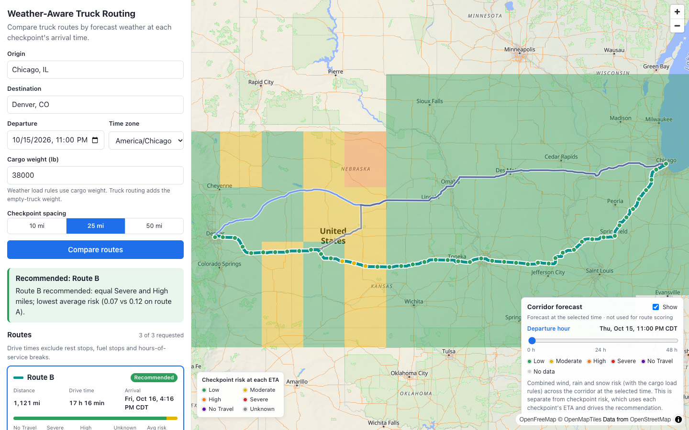
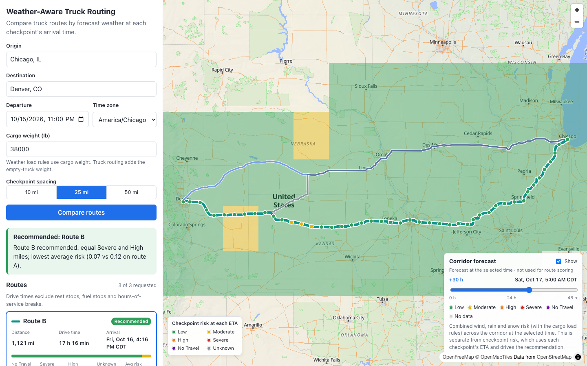
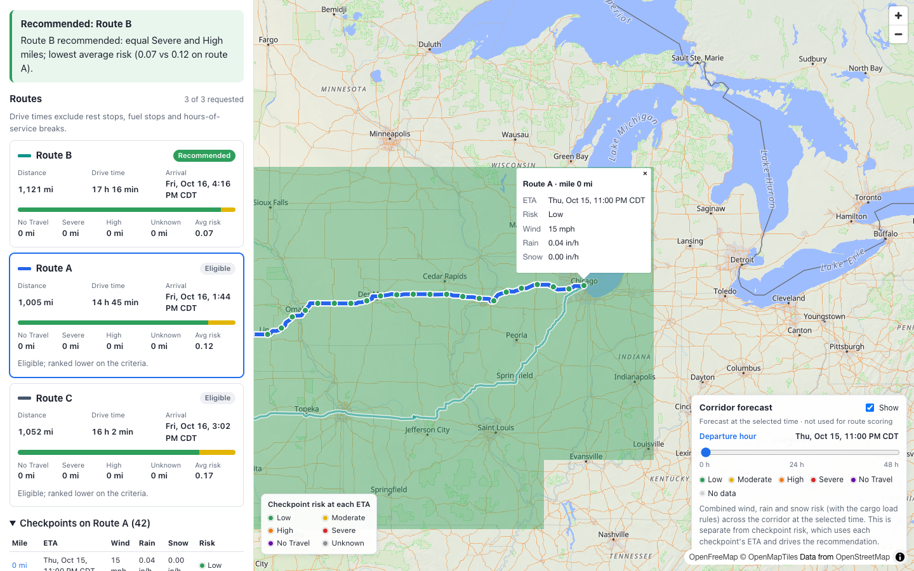
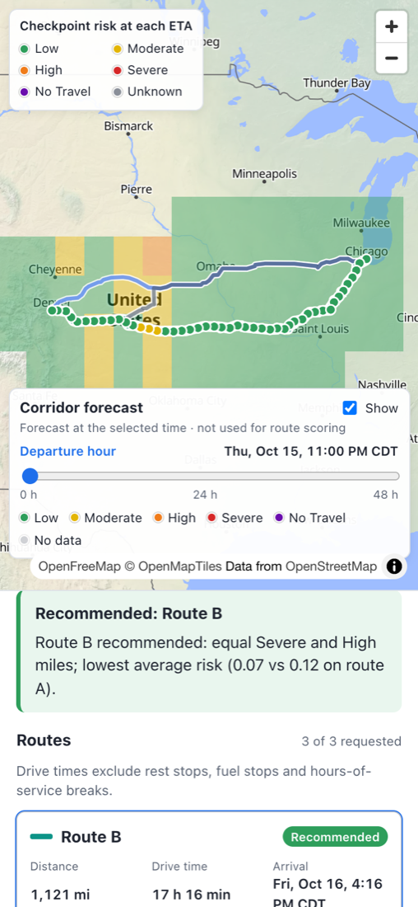

# Weather-Aware Truck Routing

React + Django app that helps a truck driver choose the safest route. It compares up to three truck routes, checks the forecast weather at the time the truck is expected to reach each checkpoint, applies the wind, rain, snow and cargo-load risk rules, and recommends the safest route with a plain-language reason.

| | |
|---|---|
| **Live app** | https://weather-aware-truck-routing-1-fw4m.onrender.com |
| **API** | https://weather-aware-truck-routing-ypg8.onrender.com/api/health/ |
| **Demo video** | _Loom walkthrough: link coming soon_ |

> The API runs on Render's free tier, which sleeps after ~15 minutes idle. The first request after that can take 30–60 s; open the API health link once to wake it.

## Screenshots

**Recommendation, ranked routes and the corridor forecast heatmap** (live, Chicago → Denver, 38,000 lb cargo). Route B is recommended although it is the longest, because the faster routes cross windier stretches.



**Heatmap slider at +30 h**: the same corridor 30 hours later. Moving the slider makes no network requests and never changes the recommendation, which uses each checkpoint's ETA.



**Route comparison and checkpoint details**: each card shows distance, drive time, arrival, miles by risk level and average risk; checkpoints are coloured by the risk at the truck's ETA.



<details>
<summary><strong>Mobile layout</strong></summary>



</details>

## How it works
1. **Routes.** The trip is geocoded and sent to HERE Routing v8 in truck mode with the loaded truck weight; HERE returns up to three alternatives with real road geometry and per-segment drive times.
2. **Checkpoints.** Each route is sampled every 10, 25 or 50 miles along the road (origin and destination included). Each checkpoint gets an ETA from HERE's segment timings, computed in UTC so daylight-saving changes cannot shift it.
3. **Weather at the ETA.** The hourly forecast is read at each checkpoint's ETA, not at departure time.
4. **Risk.** Wind, rain, snow and the cargo-load rules give each checkpoint a level from Low to No Travel. Each checkpoint stands for the stretch of road around it, so risk is summed in miles.
5. **Recommendation.** Routes with any No Travel miles, or with missing forecasts, are never recommended. The rest are ranked by fewest Severe miles, then fewest High miles, then lowest average risk, then shortest drive time.
6. **Heatmap.** Separately, a grid over the trip corridor shows forecast risk for every hour from departure to +48 h, loaded in one request.

## Using the app
1. Enter origin and destination (place name or `lat,lon`), departure time and time zone, cargo weight and checkpoint spacing.
2. The panel shows the recommendation and why, a prominent alert for any No Travel exposure, and one card per route (rank badge, distance, drive time, arrival, miles by risk level, average risk). Fewer than three routes are shown as-is with a note.
3. Click a card or a route line to select it. Its checkpoints appear on the map coloured by risk at the ETA; click a marker, or a mile in the checkpoint table, for ETA, wind, rain, snow and the factors behind the risk.
4. The **Corridor forecast** panel shows forecast risk across the trip corridor. Drag the slider from the departure hour to +48 h to see conditions at that valid time (exact time shown in the trip's time zone). Cells use the same risk rules and cargo load as route scoring; grey means no forecast. This view is independent of the recommendation. All 49 hours load in one request, so scrubbing makes no network calls.
5. **When something fails** the panel says what happened in plain language. A place that cannot be found, or an origin and destination that resolve to the same point, is shown under the relevant field (both fields for the same-point case). Temporary failures (timeouts, rate limits, provider outages, network loss) offer **Try again**, which re-sends the failed trip (the button disappears once you edit the form, so it never sends a stale trip); configuration problems such as a missing API key, and responses that would fail the same way again, do not. If only the heatmap fails, its panel says so and offers **Retry heatmap**; route scoring is unaffected. Earlier results stay on screen while re-evaluating or after a failure. If the weather provider is down, routes are still shown with every checkpoint Unknown and no recommendation.

## Tech stack and structure
- `backend/`: Django 5.2 + Django REST Framework, Python 3.12, typed with mypy strict.
  - `routing/domain/`: pure business logic with no I/O (risk rules, sampling, ETAs, forecast lookup, ranking, heatmap grid).
  - `routing/providers/`: HERE routing, geocoding and weather adapters, Open-Meteo adapter, HTTP client with timeouts and retries, forecast cache.
  - `routing/services/`: orchestration of the two endpoints.
- `frontend/`: React 19 + TypeScript (strict) + Vite 8 + MapLibre GL 6 + TanStack Query 5.
  - `src/api`: typed client, runtime response guards and query hooks. `src/map`: one MapLibre instance with route, checkpoint and heatmap layers. `src/components`: form, results and heatmap panel.
- `docs/screenshots/`: the screenshots above.
- `CLAUDE.md`, `.claude/skills/`: project rules and domain reference used while building with Claude Code.

## Local setup
Requires Python 3.12, Node 22 and a [HERE API key](https://platform.here.com) (free plan; used for routing, geocoding and weather).

```bash
cp .env.example .env            # set HERE_API_KEY; keep the file out of git (it is gitignored)

cd backend
python3 -m venv .venv
.venv/bin/pip install -r requirements-dev.txt
.venv/bin/python manage.py runserver          # http://localhost:8000

cd ../frontend
npm ci
npm run dev                     # http://localhost:5173, proxies /api to Django on :8000
```
`VITE_API_BASE_URL` stays empty in development; set it to the backend origin for production builds.

## Tests and checks
```bash
cd backend
.venv/bin/pytest                                   # 233 tests
.venv/bin/ruff check . && .venv/bin/ruff format --check .
.venv/bin/mypy .                                   # strict
.venv/bin/python manage.py check

cd ../frontend
npm test                                           # 102 tests (Vitest + Testing Library; MapLibre mocked)
npm run typecheck && npm run lint && npm run format:check
npm run build
```
Tests never call external APIs: provider tests use recorded HERE and Open-Meteo responses, and the frontend fixtures are generated from the real backend code. Covered cases include every threshold boundary, the 30,000 / 40,000 lb load limits, checkpoint spacing that does not divide the route, ETAs across a daylight-saving change, missing forecasts, No Travel and no-safe-route outcomes, fewer than three routes, provider failures and timeouts, and the heatmap slider not changing the recommendation.

## Deployment (Render)
Both parts deploy from this repository's `main` branch; every push redeploys them.

**Backend: Web Service**

| Setting | Value |
|---|---|
| Root directory | `backend` |
| Build command | `pip install -r requirements.txt` |
| Start command | `gunicorn config.wsgi:application --bind 0.0.0.0:$PORT --workers 1 --threads 4 --timeout 120` |
| Health check path | `/api/health/` |

One worker with threads keeps a single in-memory cache (several workers would each keep their own and miss each other's entries); the app mostly waits on HERE, so threads handle concurrent requests.

Environment: `PYTHON_VERSION=3.12.3`, `DJANGO_SECRET_KEY` (generated), `DJANGO_DEBUG=false`, `DJANGO_ALLOWED_HOSTS` (the service host; Render's own host name is also trusted automatically), `CORS_ALLOWED_ORIGINS` (the frontend URL), `HERE_API_KEY`, `WEATHER_PROVIDER=here`.

**Frontend: Static Site**

| Setting | Value |
|---|---|
| Root directory | `frontend` |
| Build command | `npm ci && npm run build` |
| Publish directory | `dist` |

Environment: `VITE_API_BASE_URL` (the backend URL, no trailing slash), `NODE_VERSION=22.14.0`. Nothing secret goes here: `VITE_*` values are public.

## API
All errors use one envelope: `{"error": {"code", "message", "fields"?, "provider"?}}`.

`POST /api/routes/evaluate/`
```json
{"origin": "Chicago, IL", "destination": "Denver, CO", "departure_at": "2026-10-20T08:00",
 "timezone": "America/Chicago", "load_weight_lb": 38000, "checkpoint_spacing_miles": 25}
```
- `origin`/`destination`: place text (geocoded) or `"lat,lon"`.
- `departure_at`: ISO-8601. With an offset it is used as-is; without one it is local time in `timezone`. Local times skipped by DST are rejected; repeated ones use the first occurrence and add an `ambiguous_local_time` warning. Must be from the start of the current hour (where the forecast begins) to 6 days ahead, so the whole trip fits inside the 7-day forecast.
- `load_weight_lb`: cargo, 1–80,000. `checkpoint_spacing_miles`: 10, 25 or 50.
- Response: `recommendation` (`recommended` | `no_safe_route` | `insufficient_data`, route id, reason), `routes[]` ordered by rank (GeoJSON geometry, distance, duration, arrival, `eta_method`, `severity_miles` incl. `no_travel` and `unknown`, weighted average risk, eligibility, checkpoints with ETA, weather, severity and factors), `warnings[]`, `corridor` and `heatmap_reference_at` for the heatmap call, provider metadata and assumptions.
- Warning codes: `fewer_routes_than_requested`, `no_travel`, `partial_forecast`, `weather_unavailable`, `eta_approximated`, `provider_notice`, `gross_weight_over_legal_limit`, `ambiguous_local_time`.
- A weather outage does not fail the request: routes are returned with every checkpoint Unknown and status `insufficient_data`.

`POST /api/heatmap/`
```json
{"corridor": [[-87.63, 41.88], ...], "reference_at": "2026-10-20T13:00:00Z", "load_weight_lb": 38000}
```
- Returns ≤ `HEATMAP_MAX_CELLS` grid cells and 49 hourly frames (offsets 0–48 h from `reference_at`), each with composite severity (0–4 or null = unavailable) and raw wind/rain/snow per cell. Gzip-compressed.

Error statuses: 400 invalid request; 422 place/route not found or provider rejected the request; 503 provider unavailable, rate-limited or not configured; 504 provider timeout; 429 too many requests from this client (`Retry-After` set).

Both endpoints are rate-limited per client because every call spends provider quota: `THROTTLE_EVALUATE` (default 30/hour) and `THROTTLE_HEATMAP` (60/hour). The heatmap accepts a `reference_at` up to 48 h old, so retrying for an evaluation left on screen still works (past hours come back unavailable).

## Providers
- **Routing:** HERE Routing API v8, truck mode, with up to 2 alternatives (≤ 3 routes). HERE does not guarantee alternatives; fewer routes are shown with a warning, never padded. Critical HERE notices (e.g. a road forbidden for the vehicle profile) are shown as route warnings.
- **Geocoding:** HERE Geocoding & Search v7, limited to the USA by default (`GEOCODE_COUNTRY_CODES`).
- **Weather** (`WEATHER_PROVIDER`):
  - **`here` (production):** HERE Destination Weather v3 hourly forecast with the same `HERE_API_KEY`. 168 hours from the current hour, wind in mph and rain/snow in inches. One location per request, fetched 12 at a time (`HERE_WEATHER_CONCURRENCY`, one HTTP session per worker thread) within an overall `HERE_WEATHER_DEADLINE_S` (60 s; locations not done by then are Unknown); the heatmap defaults to 80 cells on this provider. HERE does not document whether an hourly rain/snow value covers the hour before or after its timestamp, so the app uses the larger of the two neighbouring hours: risk can be overstated, never understated. A location that fails is Unknown; if every location fails, the request reports the provider error.
  - **`open-meteo`:** Open-Meteo hourly forecast, keyless for non-commercial use, up to 384 h ahead. Its free tier is counted per IP address and is exhausted on shared hosting IPs such as Render's, which is why production uses HERE.
- **Caching and speed:** forecasts are cached per ~5 km grid cell and truck routes per identical request for `CACHE_TIMEOUT_S` (15 min); geocoding results for 24 h. Failed lookups are never cached. An identical trip within that window is answered from a response cache without any provider calls or recomputation. Provider clients and the weather worker threads live for the whole process, so HTTPS connections are reused instead of re-negotiated on every request, and origin and destination are geocoded in parallel. Route lines sent to the browser are simplified to about 20 m (≈80% smaller responses); checkpoints, ETAs and scoring always use the full geometry.
- Provider calls have timeouts, at most 2 retries (timeouts, connection errors, 5xx, rate limits with a short Retry-After) and a 20 s budget per call. TLS and URL errors fail fast. Without `HERE_API_KEY`, requests return a clear 503 "not configured" error.
- **Map tiles:** OpenFreeMap (no key).
- All settings are listed in `.env.example`.

## Assumptions and interpretation of the risk rules
- **Boundaries.** The brief's ranges overlap (e.g. rain "0.10–0.25" and "0.25–0.50"). Each boundary value belongs to the higher band, except rain 1.00 in/hr and snow 3.0 in/hr, which stay Severe because No Travel is defined as strictly greater.

  | | Low | Moderate | High | Severe | No Travel |
  |---|---|---|---|---|---|
  | Wind (mph) | <25 | 25 to <35 | 35 to <45 | 45 to <55 | ≥55 |
  | Rain (in/hr) | <0.10 | 0.10 to <0.25 | 0.25 to <0.50 | 0.50 to 1.00 | >1.00 |
  | Snow (in/hr) | <0.5 | 0.5 to <1.0 | 1.0 to <2.0 | 2.0 to 3.0 | >3.0 |
- **Load rules.** Wind ≥55 mph is No Travel for any load. Wind 45 to <55 mph with load >30,000 lb is No Travel. Wind 35 to <45 mph with load >40,000 lb is at least Severe. Exactly 30,000 / 40,000 lb do not trigger. Final checkpoint risk is the maximum of all components.
- **Wind** is sustained wind speed. Gusts are not scored.
- **Missing data** is Unknown, never Low. A checkpoint with a missing value is Unknown unless a known value already gives No Travel.
- **Forecast timing.** Wind is interpolated linearly between hours. Rain and snow use the forecast hour containing the ETA (with HERE, the larger of the two neighbouring hours, see Providers). ETAs outside forecast coverage are Unknown; current conditions are never substituted.
- **ETA.** Departure instant + elapsed driving time from HERE's per-segment durations, computed in UTC (DST-safe). Falls back to a proportional-distance estimate, flagged in the response, if segment timing is missing. Rest, fuel and hours-of-service stops are not modeled.
- **Mileage.** Each checkpoint represents the stretch between the midpoints to its neighbours; these stretches cover the route exactly. Severity totals are miles, not checkpoint counts.
- **Average risk** is distance-weighted over miles with known weather, using Low=0, Moderate=1, High=2, Severe=3, No Travel=4.
- **Recommendation.** Routes with any No Travel miles are ineligible. Routes with Unknown miles are unverified and never recommended. Eligible routes are ordered by Severe miles, High miles, average risk, duration, then route ID. If all routes have No Travel → `no_safe_route`; if the rest lack data → `insufficient_data`.
- **Truck weight.** The entered weight is the cargo load; the weather load rules use it directly. For truck routing restrictions, HERE receives the loaded truck weight = empty truck (`TRUCK_EMPTY_WEIGHT_LB`, default 35,000 lb) + cargo, in kg.

## Known limitations
- **Departure window:** up to 6 days ahead, because HERE forecasts 7 days.
- **Weather quota:** each trip makes one HERE weather request per unique checkpoint location (about 100–200 for a 1,000-mile trip) plus up to 80 for the heatmap, all counted against the HERE plan. Repeat views within 15 minutes come from the cache.
- **Heatmap resolution:** on long trips the 80-cell heatmap is coarse (about 1.6° squares); raise `HEATMAP_MAX_CELLS` for finer cells at the cost of more requests.
- **Drive time only:** hours-of-service breaks, fuel and rest stops are not modeled.
- **Cold starts:** the free backend instance sleeps when idle.
- **Routing test fixture:** the HERE routing tests use a sample built from HERE's API specification; live routing has been verified against the deployed app.
